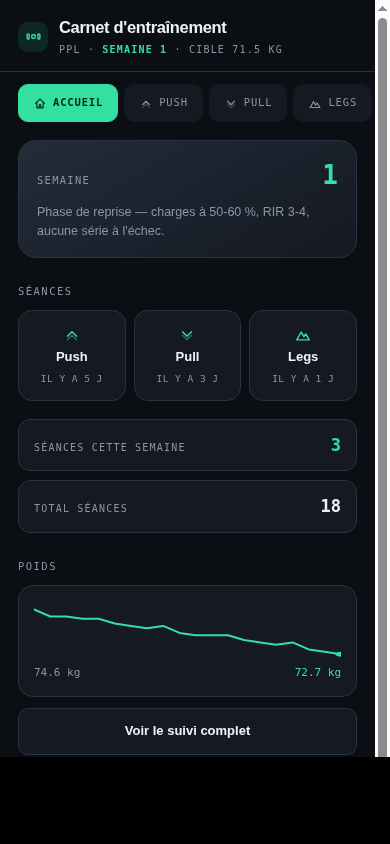
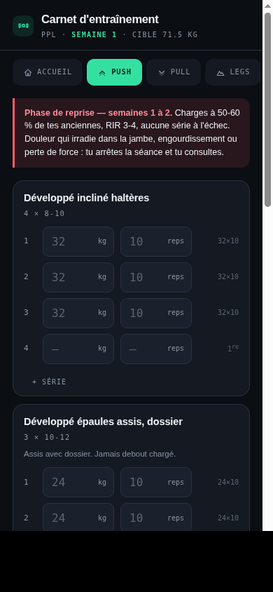
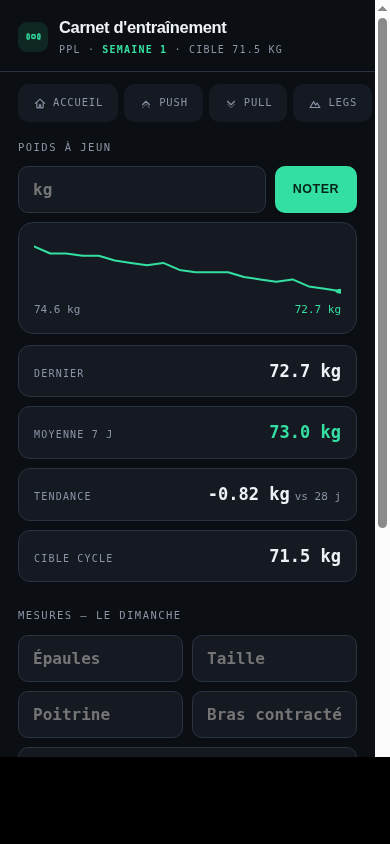

# 🏋️ Carnet — Gym Tracker

A workout tracker for a **Push / Pull / Legs** program: a single-file frontend backed by a small Node.js server, so your data lives in a real database instead of being trapped in one browser. Open it on your phone and log your sets.

> **Status**: the data layer and training analytics are in place. An AI coaching chat and meal-photo logging are planned next — see [Roadmap](#roadmap).

<p align="center">
  
  
  
</p>

## Features

- **Dashboard** — current program week, quick links to your last Push/Pull/Legs session, weekly session count, and a weight trend sparkline at a glance.
- **Push / Pull / Legs logging** — pre-filled with your program's sets/reps targets, shows your previous weights as placeholders so you always know what to beat, and flags priority exercises.
- **Rest timer** — 90s / 3min one-tap timers built into the logging bar.
- **Back-health check-in** — quick tap per session (fine / slight discomfort / pain), with an automatic warning if pain is reported.
- **Journal** — full session history with volume per session, per-exercise breakdown, and one-tap delete (with confirmation).
- **Suivi (tracking)** — fasted body weight with a 7-day / 28-day trend, training volume per session (color-coded by Push/Pull/Legs), per-exercise progress charts (pick any exercise, see its best weight over time), body measurements, and a shoulder-to-waist ratio.
- **Synced storage** — data is saved to a real database (via a small backend) so it survives across devices and isn't lost if you clear your browser. Export to JSON any time as a manual backup, import to restore. A guarded "erase everything" option lives in Données. If the server is briefly unreachable, it falls back to the browser's local storage so you never lose a set mid-workout.
- **Installable** — includes a web app manifest and icons, so it can be added to your phone's home screen and used like a native app.
- **Access code** — a single shared secret (set by whoever deploys it) gates read/write access, since the backend is reachable over the internet.

## Architecture

```
Browser (index.html)  <-->  Node/Express server  <-->  Turso (hosted SQLite)
```

The frontend is still one static HTML file (markup, styles, and UI logic). The `server/` folder is a small Express app that serves that file **and** exposes two endpoints — `GET/PUT /api/state` — backed by [Turso](https://turso.tech) (a free hosted SQLite). Every request must carry the access code as a bearer token; without it, the API returns 401.

## Getting started

### Run it locally

```bash
git clone https://github.com/hediiimohamed/gym_tracker.git
cd gym_tracker/server
cp .env.example .env   # fill in TURSO_DATABASE_URL, TURSO_AUTH_TOKEN, APP_TOKEN
npm install
npm start              # serves the app + API on http://localhost:3000
```

### Deploy it for real (free)

1. **Database** — create a free database at [turso.tech](https://turso.tech), then grab its URL and auth token from the "Connect" panel.
2. **Server** — push this repo to GitHub, then create a new Web Service on [Render](https://render.com) pointing at it (the included `render.yaml` preconfigures the build/start commands — Render will just ask you to fill in the three environment variables: `TURSO_DATABASE_URL`, `TURSO_AUTH_TOKEN`, and `APP_TOKEN`, the last one being any secret string you make up yourself).
3. Open the Render URL on your phone, enter your `APP_TOKEN` once when prompted, and "Add to Home Screen".

Static GitHub Pages hosting (no backend) is no longer sufficient once a server is involved — the Render URL is now the one to use and install.

## Customizing your program

Everything you're likely to want to change lives in one place: the `CONFIG` block at the top of the `<script>` in [index.html](index.html).

```js
const CYCLE = {
  start:      "2026-08-25",   // cycle start date
  weightGoal: 71.5,           // target weight (kg) by end of cycle
  rampWeeks:  2,              // reduced-load weeks after a break
};

const PROGRAM = {
  push: { label: "Push", ex: [
    { id:"dc_incl", n:"Incline dumbbell press", s:4, r:"8-10" },
    // ...
  ]},
  // pull, legs...
};
```

- Add/remove exercises by editing the `ex` arrays — each needs a unique, **stable** `id` (it's used as the history key; changing it loses that exercise's history).
- `s` = sets, `r` = rep range shown as a hint, `prio:1` highlights the exercise as a priority, `note` shows a short reminder under the exercise name.
- Everything below the config block is app logic and shouldn't need touching.

## Project structure

```
gym_tracker/
├── index.html             # the entire frontend: markup, styles, and logic
├── manifest.json           # PWA manifest (installable, home screen icon)
├── icons/                   # favicon + app icons
├── docs/screenshots/        # images used in this README
├── render.yaml               # Render deployment blueprint
└── server/                    # backend: Express + Turso (hosted SQLite)
    ├── index.js                 # HTTP server, auth, static file serving
    ├── db.js                    # Turso client + schema
    └── .env.example              # required environment variables
```

## Tech

Frontend: vanilla HTML/CSS/JS, no framework, no build step. Backend: Node.js + Express + [`@libsql/client`](https://github.com/tursodatabase/libsql-client-ts) talking to Turso. Deliberately minimal — one data table, two endpoints — so it's easy to read, fork, and extend.

## Privacy & data

Your data lives in your own Turso database, reachable only with your `APP_TOKEN`. Nobody at Anthropic, Render, or Turso can read it without that token; it isn't shared with any third party. Still, treat the token like a password — anyone who has it can read and overwrite your history. Use the **Export** button in the Données tab regularly for a manual JSON backup.

## Roadmap

Planned next, in order:

1. ~~Backend + real database~~ (done)
2. ~~More analytics and charts on existing session/weight data~~ (done)
3. An AI coaching chat (Claude) that can see your logged sets and answer questions about your training
4. Meal photo logging — snap a photo, get a nutrition estimate

## Disclaimer

The back-health check-in and load-ramp guidance are personal notes, not medical advice. If you're recovering from an injury or experiencing pain, consult a healthcare professional.

## License

Personal project, shared as-is — feel free to fork it and adapt it to your own program.
